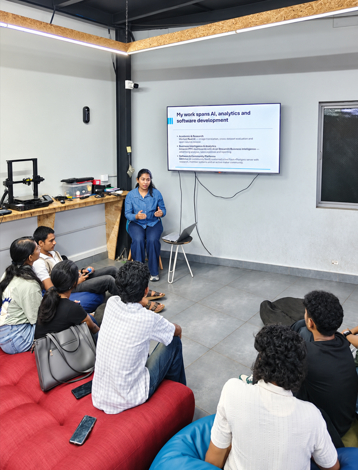
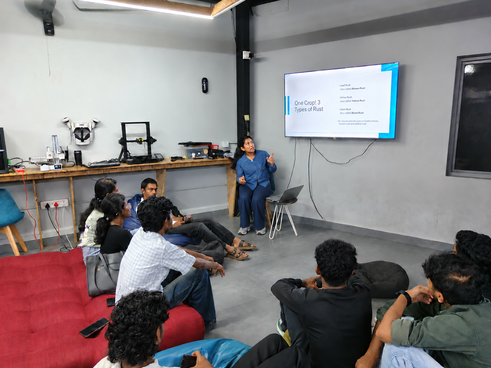
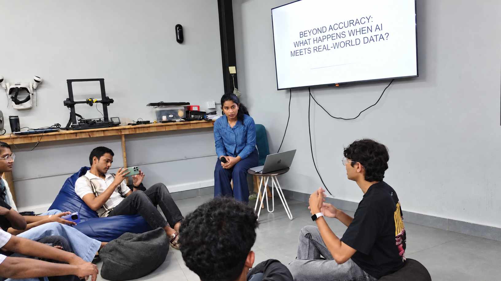

# Beyond Accuracy: What Happens When AI Meets Real-World Data?

**AI Wednesday · TinkerSpace Kochi · 28 October 2026**  
**Speaker:** Devanandha Vellaramkuzhiyil Shaji

## About the session

I delivered a public, in-person technical session using my independent wheat rust detection project to explore why high accuracy on one dataset may not carry over to images from another source.

The session connected model development with evaluation practice: tracing predictions to their true labels, testing unfamiliar sources, investigating confident errors, and interpreting visual explanations cautiously.

## Slides and resources

- [Download the presentation slides (PDF, without speaker notes)](slides.pdf)
- [Download the editable PowerPoint (without speaker notes)](slides.pptx)
- [Official TinkerHub event listing](https://tinkerhub.org/events/Q2Y0PRTW2U/ai-wednesday)
- [LinkedIn session recap](https://lnkd.in/p/dsHjJuZT)
- [Wheat Rust AI project](https://github.com/devanandha/wheat-rust-ai-detection)
- [Interactive research demo](https://devanandha-wheat-rust-ai.streamlit.app/)

## Topics covered

- Healthy-only anomaly detection and lessons from its evaluation failures.
- Transfer learning with MobileNetV2 for healthy, brown rust and yellow rust classification.
- Internal validation compared with evaluation on images from a separate source.
- Training-source mixture experiments and the limits of transfer to excluded sources.
- Why confidence does not establish correctness.
- Grad-CAM: investigating influential regions without treating a heatmap as proof of disease-specific reasoning.

## Key lessons

Strong internal validation does not establish reliable generalisation. Training-source composition can influence performance, and differences in class coverage limit what source comparisons can establish. Visual explanations are investigative aids and require further validation.

The presentation is a research and educational resource. It does not establish field-ready crop diagnosis.

## Session photographs

*Discussing wheat rust and the classification task.*

*Interaction with participants during the session.*

These public recap photographs are AI-retouched versions of event photographs. Original photographs and video clips are retained separately.
