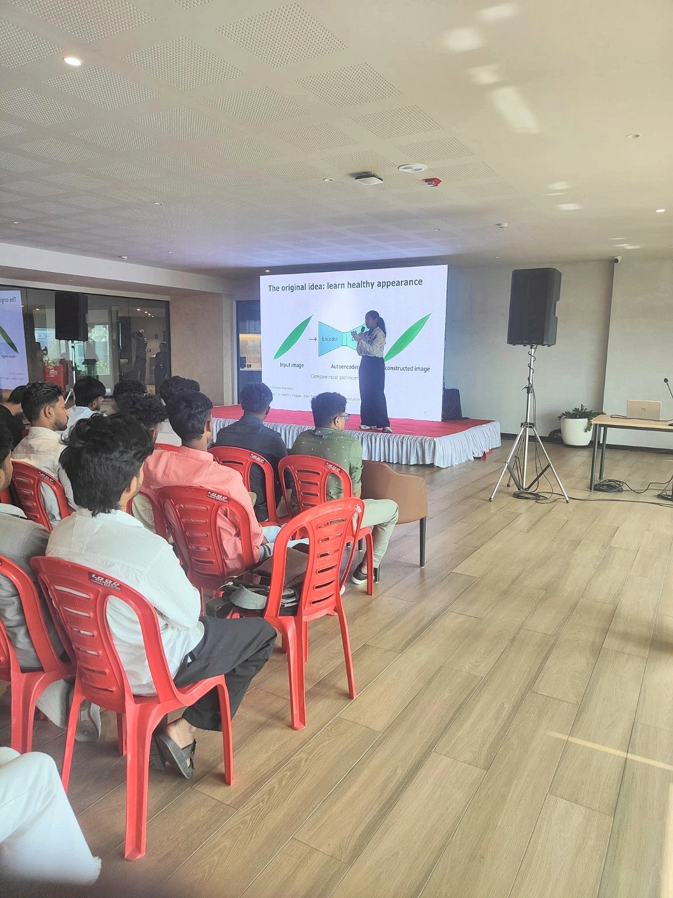
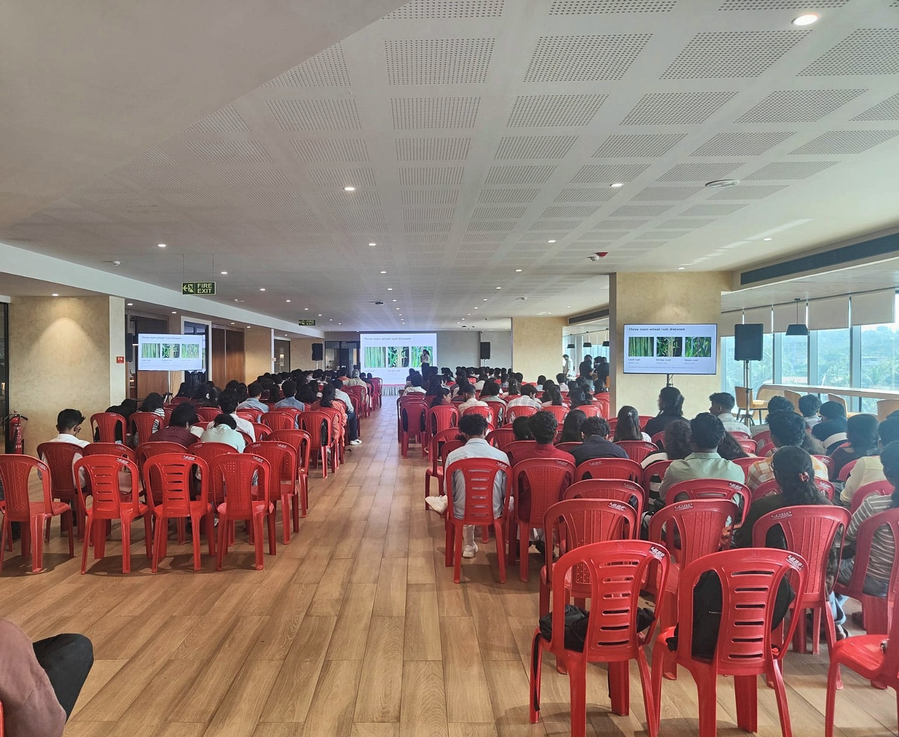
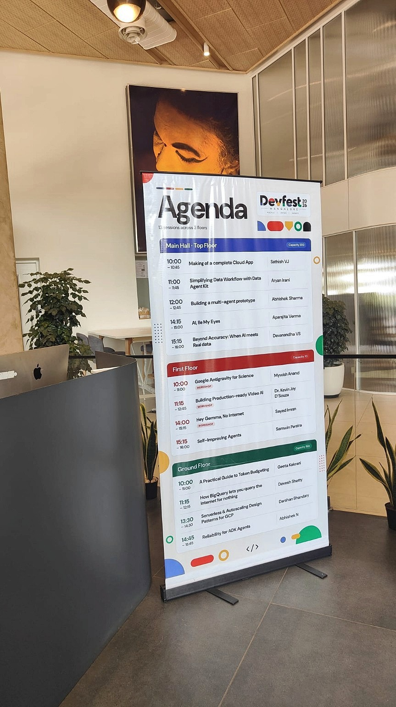
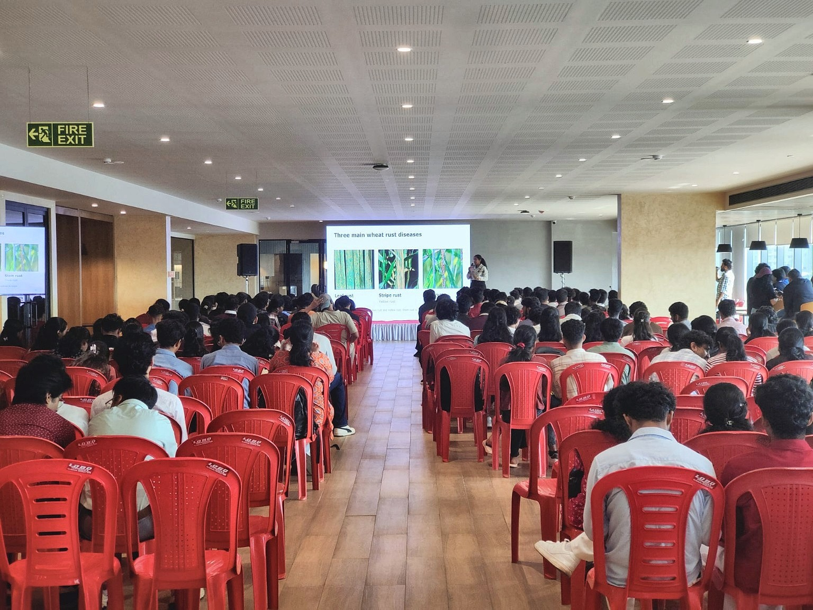

# Beyond Accuracy: When AI Meets Real Data

**DevFest Mangaluru 2026 · GDG Cloud Mangalore · 14 November 2026**  
**Speaker:** Devanandha Vellaramkuzhiyil Shaji  
**Location:** wrkwrk Triangle, Mangaluru, Karnataka, India  
**Officially listed session:** 15:15–16:00 IST, Track 1 (top floor)

[Official DevFest event agenda](https://gdg.community.dev/events/details/google-gdg-cloud-mangalore-presents-devfest-mangaluru-2026/) · [Wheat Rust AI repository](../../README.md) · [Live research demo](https://devanandha-wheat-rust-ai.streamlit.app/)

## Session at a glance

This in-person technical presentation used my independent, open-source Wheat Rust AI work to examine a common machine-learning evaluation problem: **why high validation accuracy on one image source does not establish reliable performance on unfamiliar data**.

I presented the difference between internal and external evaluation, a confusion-matrix-based failure analysis, the limits of confidence scores, and what the negative and mixed results taught me about model assessment.

The official GDG Cloud Mangalore agenda independently lists me as a speaker for **“Beyond Accuracy: When AI meets Real data”** on 14 November 2026. Its Track 1 capacity is an event-room capacity, **not** a verified count of attendees at my session.

## Event photographs and official agenda

The following original event photographs document the delivered talk, visible audience, and venue agenda. They are provided for factual documentation; no precise session attendance figure is inferred from the photographs.

### Speaking at DevFest Mangaluru

*Presenting the healthy-only autoencoder approach and explaining its evaluation.*

### Audience during the session

*Wide view of the developer audience during the presentation. This photograph is not an attendance register.*

### Official printed programme

*Venue agenda board showing the talk “Beyond Accuracy: When AI meets Real data,” speaker Devanandha VS, and the scheduled 15:15–16:00 session.*

### Additional stage and audience view

*Another view of the presentation, with the speaker and audience in the same frame.*

## The technical problem

The original classifier uses ImageNet-pretrained **MobileNetV2** features and a three-class classification head for *Healthy*, *Brown rust*, and *Yellow rust* wheat-leaf images.

| Evaluation | Correct / images | Accuracy | Interpretation |
|---|---:|---:|---|
| Original internal validation split | 728 / 737 | **98.78%** | Strong performance on images from the original dataset |
| Separate external-source evaluation | 188 / 489 | **38.45%** | Substantially weaker transfer to a different image source |

These results are from the documented model and evaluation settings in the [main project README](../../README.md) and [external-validation report](../../docs/EXTERNAL_VALIDATION.md). They are not estimates of accuracy in farm deployment.

The internal and external results differ by **60.33 percentage points**. That difference motivated further investigation rather than a claim that the original model was field-ready.

### Looking beyond a single accuracy number

For the external **Yellow rust** class, the confusion matrix shows that **15 of 239** images were correctly identified as Yellow rust; the remainder were predicted as another class. A single overall score hides this class-level failure.

The talk also examined why a highly confident prediction can still be wrong, and why a confusion matrix and individual errors should be read together.

### Testing alternative explanations

Follow-up work in the repository includes:

- Separate-source evaluation and comparison of MobileNetV2, EfficientNetB0, and ResNet50.
- Exact and near-duplicate checks on the original train/validation split.
- Source-mixture and source-exclusion experiments, including their limitations.
- Healthy-only autoencoder evaluation, retaining negative results rather than omitting them.
- Grad-CAM investigations, with care not to equate model-influential image regions with independently confirmed disease lesions.

The experiments do **not** establish that a particular background shortcut caused the observed generalisation gap; dataset shift and class/source coverage require careful interpretation. See [failure analysis](../../docs/FAILURE_ANALYSIS.md), [baseline comparison](../../docs/BASELINE_COMPARISON.md), and the [source-exclusion retrospective audit](../../docs/WHEAT_RUST_SOURCE_EXCLUSION_20261023.md).

## Three takeaways

1. **Accuracy is conditional.** Always state the dataset, split, class coverage, and evaluation setting.
2. **Failure analysis is useful research.** Negative or unexpectedly weak results can reveal which question needs to be investigated next.
3. **External evaluation matters.** A change in data source can change the conclusion, even when the original validation score was high.

## Community discussion and feedback

An attendee subsequently shared a public LinkedIn recap that mentioned the session and its lesson about the gap between validation accuracy and real-world reliability. In follow-up comments, the attendee described the session as informative and said they wanted to explore the ideas further.

The original screenshots are retained as part of the event record. **A verified permalink to that attendee's post has not yet been added here**; the feedback is not presented as a measured audience-impact study.

I am grateful to GDG Cloud Mangalore and the event team for the opportunity to share the work with the developer community.

## Talk resources and follow-up

- [Official DevFest Mangaluru 2026 programme](https://gdg.community.dev/events/details/google-gdg-cloud-mangalore-presents-devfest-mangaluru-2026/)
- [Full Wheat Rust AI research project](../../README.md)
- [Interactive Streamlit demo](https://devanandha-wheat-rust-ai.streamlit.app/)
- [External validation methodology and results](../../docs/EXTERNAL_VALIDATION.md)
- [Confusion matrix and failure analysis](../../docs/FAILURE_ANALYSIS.md)
- [October source-exclusion study and cautions](../../docs/WHEAT_RUST_SOURCE_EXCLUSION_20261023.md)
- [Earlier AI Wednesday community talk, 28 October 2026](../2026-10-28-ai-wednesday/README.md)

**Presentation slides:** A public slide export has not yet been uploaded to this folder. It should be added only after confirming the final presented version and removing any private speaker notes.

## Evidence and provenance

| Item | Basis | Status |
|---|---|---|
| Event, date, speaker and scheduled session | Official GDG Cloud Mangalore agenda | Publicly verifiable using the event link above |
| Technical findings | Linked project code, reports and evaluation files | Publicly documented, with scope limitations |
| Delivered-session photographs | Four original event photographs, including stage and audience views | Published above; photos corroborate presentation delivery but do not establish an exact attendance figure |
| Attendee's independent reflections | Public LinkedIn post/comments captured in screenshots | Primary post URL still to be added |
| Session attendance or speaker-selection process | Would require organiser confirmation | Not claimed or quantified |

This page documents a technical knowledge-sharing event, not a controlled study of educational impact or proof of professional award selection.

## Research and responsible-use note

This work is an educational and research prototype, not a validated field-diagnostic system. The evaluation concerns the dataset splits and model versions described in the linked reports. Any wider deployment would require independent field testing, expert review, calibration and monitoring.
